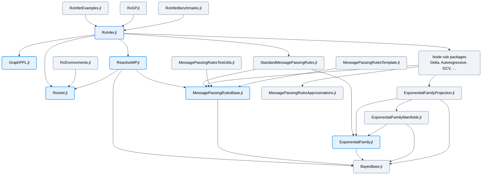

# Reactive Bayes

Open source software for reactive, efficient and scalable Bayesian inference.

Welcome to the Reactive Bayes organization! We develop and maintain a suite of Julia packages for probabilistic programming and Bayesian inference with a focus on reactive and message-passing based inference algorithms.

## Key Packages

- **[RxInfer](https://github.com/ReactiveBayes/RxInfer.jl)**
The central high-level probabilistic programming framework that enables reactive Bayesian inference on factor graphs through reactive message passing. It integrates tools including [probabilistic graphical model definition](https://github.com/ReactiveBayes/GraphPPL.jl) and [reactive message-based Bayesian inference](https://github.com/ReactiveBayes/ReactiveMP.jl), loads the rule packages most models use, and supports compiling inference with [Reactant.jl](https://github.com/EnzymeAD/Reactant.jl) (partially, see the [example](https://examples.rxinfer.com)).
- **[ReactiveMP](https://github.com/ReactiveBayes/ReactiveMP.jl)**
An efficient message passing-based Bayesian inference engine that implements the core algorithms for performing high-performance, reactive message passing on factor graphs. It holds no rules of its own: it runs the rules of the rule packages below.
- **[GraphPPL](https://github.com/ReactiveBayes/GraphPPL.jl)**
A probabilistic programming language for specifying probabilistic graphical models as factor graphs. It provides a high-level domain-specific language for model creation and works seamlessly with RxInfer for inference.
- **[ExponentialFamily](https://github.com/ReactiveBayes/ExponentialFamily.jl)**
Extends [Distributions.jl](https://github.com/JuliaStats/Distributions.jl) with comprehensive implementations of a collection of exponential family distributions.
- **[Rocket](https://github.com/ReactiveBayes/Rocket.jl)**
A reactive programming framework providing core primitives for event handling and streaming for Julia, inspired by [RxJS](https://github.com/ReactiveX/rxjs). It forms the backbone for reactive computations in the ecosystem.

## Message Passing Rules

Nodes and their message passing rules are declared with **[MessagePassingRulesBase](https://github.com/ReactiveBayes/MessagePassingRulesBase.jl)** and live in registered packages of their own:

- **[StandardMessagePassingRules](https://github.com/ReactiveBayes/StandardMessagePassingRules.jl)**: the standard distributions, arithmetic, logic, the mixtures and Probit.
- One package per other node: [Delta](https://github.com/ReactiveBayes/DeltaMessagePassingRules.jl), [GaussianCoupling](https://github.com/ReactiveBayes/GaussianCouplingMessagePassingRules.jl), [Autoregressive](https://github.com/ReactiveBayes/AutoregressiveMessagePassingRules.jl), [SoftDot](https://github.com/ReactiveBayes/SoftDotMessagePassingRules.jl), [ContinuousTransition](https://github.com/ReactiveBayes/ContinuousTransitionMessagePassingRules.jl), [Polya](https://github.com/ReactiveBayes/PolyaMessagePassingRules.jl), [BIFM](https://github.com/ReactiveBayes/BIFMMessagePassingRules.jl), [Flow](https://github.com/ReactiveBayes/FlowMessagePassingRules.jl), [DiscreteTransition](https://github.com/ReactiveBayes/DiscreteTransitionMessagePassingRules.jl) and [GCV](https://github.com/ReactiveBayes/GCVMessagePassingRules.jl).
- **[MessagePassingRulesApproximations](https://github.com/ReactiveBayes/MessagePassingRulesApproximations.jl)**: the numerical approximations the rules share, such as the unscented transform, linearization and Gauss–Hermite cubature.
- **[MessagePassingRulesTestUtils](https://github.com/ReactiveBayes/MessagePassingRulesTestUtils.jl)**: table-driven tests of rules, down to a rule-coverage gate.
- **[MessagePassingRulesTemplate](https://github.com/ReactiveBayes/MessagePassingRulesTemplate.jl)**: the template a new rule package starts from.

## Supporting Packages

- **[ExponentialFamilyManifolds](https://github.com/ReactiveBayes/ExponentialFamilyManifolds.jl)**
Provides manifold representations of exponential family distributions, enabling advanced optimization workflows with [Manopt.jl](https://github.com/JuliaManifolds/Manopt.jl). It facilitates efficient parameter tuning in natural parameter spaces.

- **[ExponentialFamilyProjection](https://github.com/ReactiveBayes/ExponentialFamilyProjection.jl)**
Enables projection of (un-normalized) log probability density functions onto exponential family distributions. It uses optimization techniques from [Manopt.jl](https://github.com/JuliaManifolds/Manopt.jl) and leverages [ExponentialFamilyManifolds.jl](https://github.com/ReactiveBayes/ExponentialFamilyManifolds.jl).

- **[BayesBase](https://github.com/ReactiveBayes/BayesBase.jl)**
Defines and re-exports core methods and utilities for Bayesian computation. It provides a shared foundation for the Reactive Bayes ecosystem.

## Application specific packages

- **[RxInferExamples](https://github.com/ReactiveBayes/RxInferExamples.jl)**
Contains example applications using RxInfer.
- **[RxEnvironments](https://github.com/ReactiveBayes/RxEnvironments.jl)**
Provides reactive environments for agents.
- **[RxGP](https://github.com/ReactiveBayes/RxGP.jl)**
Sparse Gaussian process factor nodes and variational message passing update rules for Sparse Variational Gaussian Process (VSGP) models within the RxInfer ecosystem. It enables embedding sparse GP computations directly into Forney-style factor graphs, with automatic inference over inducing variables, noise precisions, hyperparameters, and uncertain inputs.

## Development and Tooling

- **[RxInferBenchmarks.jl](https://github.com/ReactiveBayes/RxInferBenchmarks.jl)**
A performance benchmarking system that tracks RxInfer.jl's compilation time, execution speed, memory usage, and garbage collection across Julia versions and dependencies over time. Results are published to an interactive dashboard at [reactivebayes.github.io/RxInferBenchmarks.jl](https://reactivebayes.github.io/RxInferBenchmarks.jl/).

Our packages are designed to work together seamlessly to provide:

- **Reactive Inference**: Real-time updates as new data arrives
- **Message Passing**: Efficient inference through local computations
- **Scalability**: Handle large models and datasets
- **Flexibility**: Mix and match components for your specific needs

We welcome contributions from the community! Check out our individual package repositories for more details on how to get involved.
